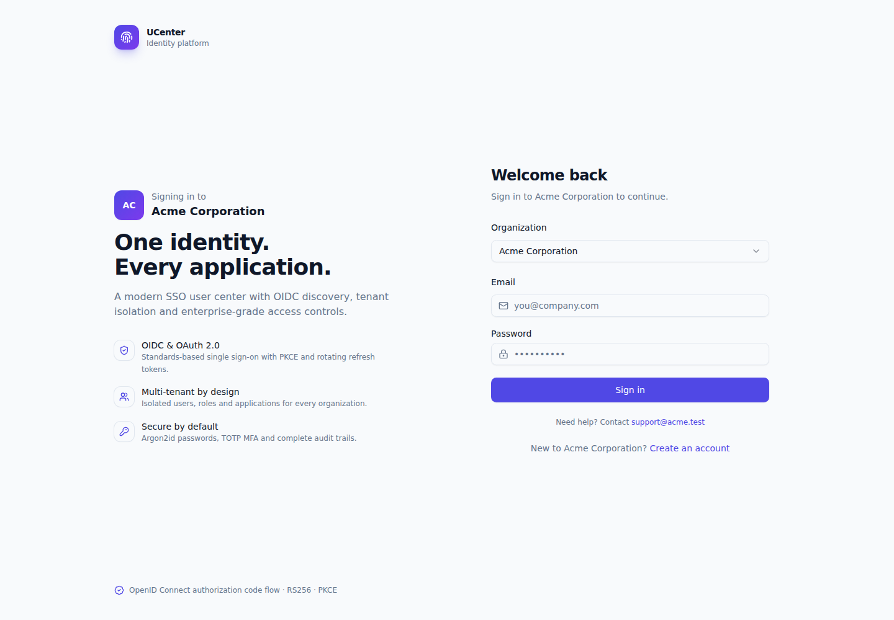
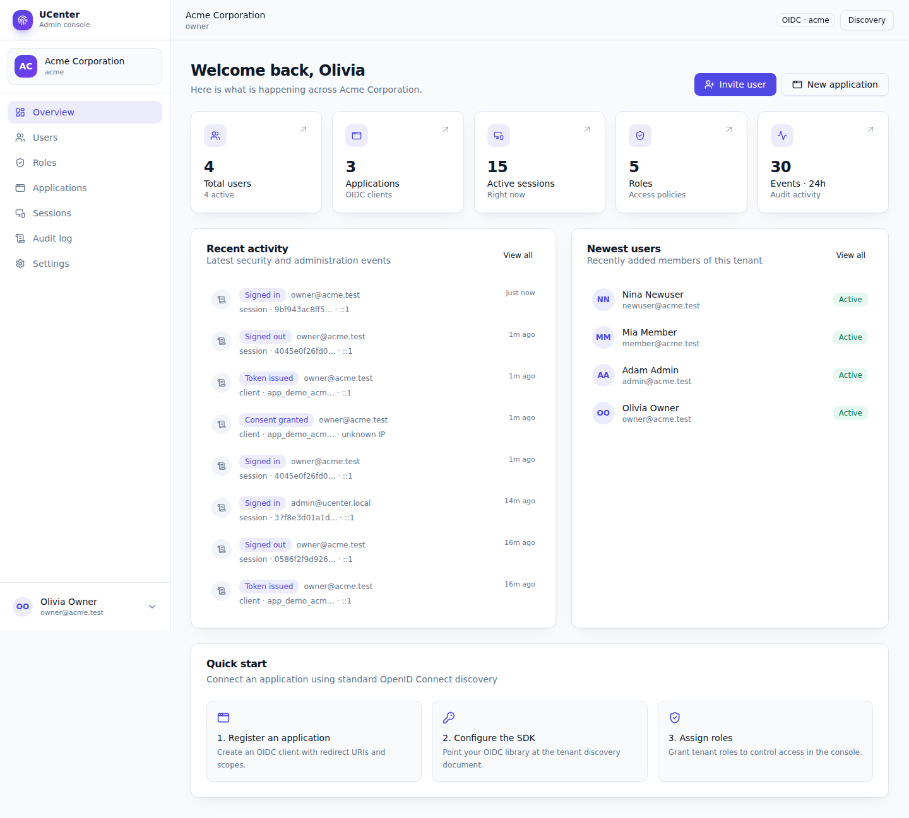
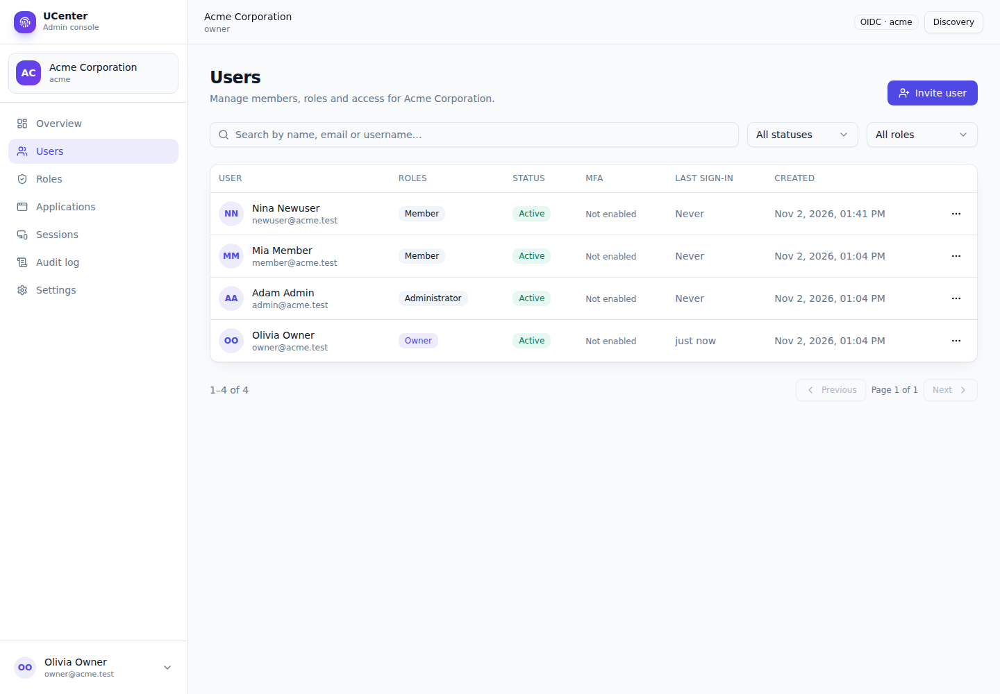
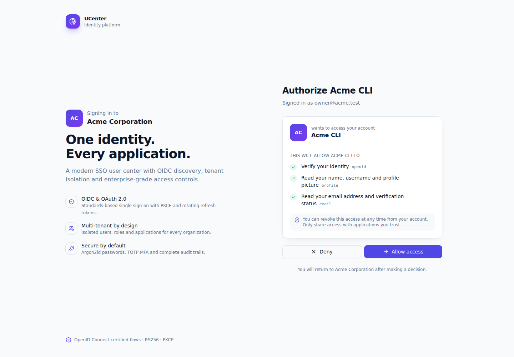
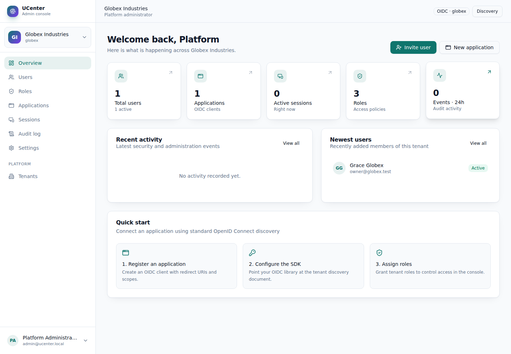
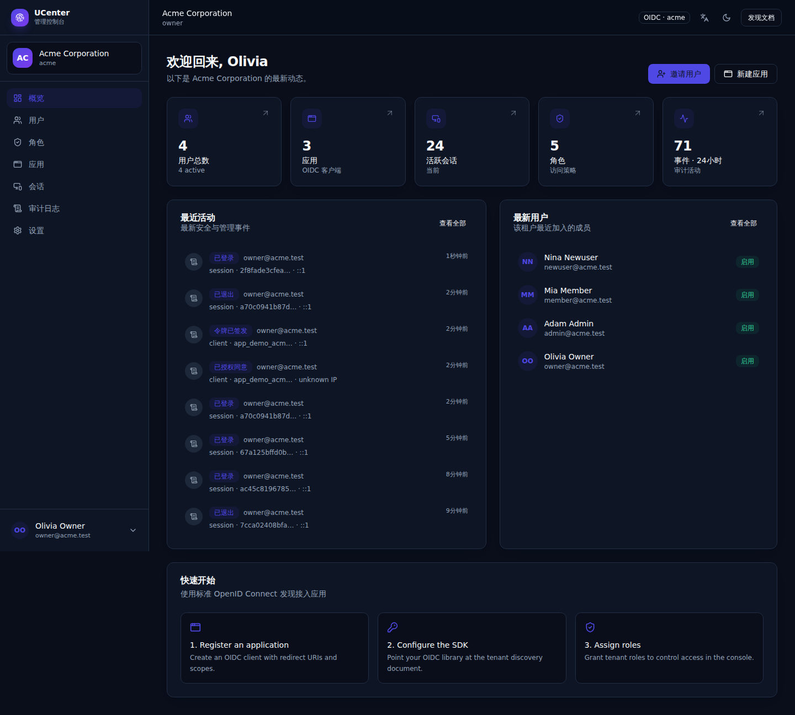
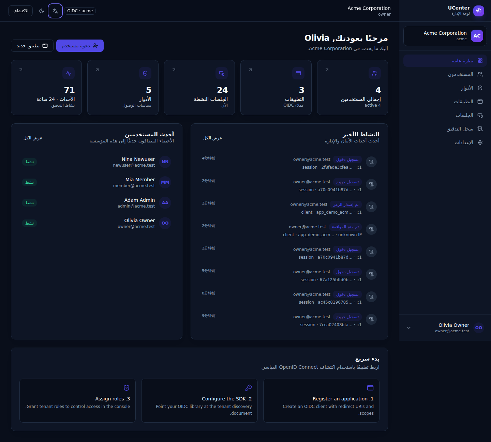

# UCenter — Multi-tenant SSO & Identity Center

A self-hosted, multi-tenant identity provider and user center with a standards-based
OpenID Connect (OIDC) provider, a React admin console, and a Go + MongoDB backend.

Each tenant gets its own issuer, signing key, users, roles, OIDC clients, sessions and
audit trail. A single platform administrator can manage every tenant from one console.



## Highlights

- **OpenID Connect provider** — discovery, authorization code + PKCE, ID tokens, userinfo,
  JWKS, refresh token rotation, revocation, introspection and RP-initiated logout.
- **True tenant isolation** — per-tenant issuer (`/t/{slug}`), RSA signing key, roles,
  clients, sessions and audit events. Global identities can belong to multiple tenants.
- **Complete admin console** — users, roles & permissions, OIDC applications, active
  sessions, audit log, branding and security policy.
- **MCP access** — a Streamable HTTP Model Context Protocol server lets AI clients
  (Claude Desktop, Cursor, custom agents) inspect and manage a tenant with scoped,
  revocable API tokens. See [docs/MCP.md](docs/MCP.md).
- **Platform administration** — create tenants, assign owners, enable/disable tenants and
  switch between organizations without re-authenticating.
- **Security first** — Argon2id passwords, TOTP MFA with hashed recovery codes, exact
  redirect URI matching, PKCE enforcement for public clients, rotating refresh tokens,
  one-time client secrets, login rate limiting, trusted-proxy configuration and CSP.
- **Light, dark and system themes** — persisted per browser, with a pre-paint theme
  bootstrap to avoid flashes, and theme-aware toasts and tenant branding.
- **10 languages + RTL** — English, 简体中文, Español, हिन्दी, العربية, Português, বাংলা,
  Русский, 日本語 and Français. Arabic switches the whole layout to RTL; dates and
  relative times use the selected locale.
- **Polished UX** — React 19, Tailwind CSS, shadcn/ui components, responsive layouts,
  tenant branding and accessible Radix primitives.

### Screenshots

| Admin overview | Users |
| --- | --- |
|  |  |

| OIDC consent | Platform tenant switcher |
| --- | --- |
|  |  |

| Dark theme · 简体中文 | Dark theme · العربية (RTL) |
| --- | --- |
|  |  |

## Tech stack

| Layer | Technology |
| --- | --- |
| Backend | Go 1.24, Gin, MongoDB driver |
| Database | MongoDB 6/7 (TTL indexes for sessions, codes and requests) |
| Tokens | JWT RS256 (`golang-jwt`), per-tenant RSA keys, JWKS |
| Frontend | React 19, TypeScript, Vite, React Router, TanStack Query |
| UI | Tailwind CSS 3, shadcn/ui-style components, Radix UI, lucide-react |
| Tooling | pnpm, Make, Docker / Docker Compose |

## Quick start

### Prerequisites

- Go **1.24+**
- Node.js **20+** and pnpm **10+**
- MongoDB **6+** running locally (default `mongodb://127.0.0.1:27017`)

### 1. Configure

```bash
cp .env.example .env
# edit .env if your MongoDB or public URL differs
```

### 2. Install and seed demo data

```bash
make install
make seed
```

The seed is idempotent and creates two tenants, demo users and OIDC clients:

| Account | Password | Access |
| --- | --- | --- |
| `admin@ucenter.local` | `Admin12345!` | Platform administrator |
| `owner@acme.test` | `Password123!` | Acme owner |
| `admin@acme.test` | `Password123!` | Acme administrator |
| `member@acme.test` | `Password123!` | Acme member |
| `owner@globex.test` | `Password123!` | Globex owner |

Demo OIDC clients:

| Client | Secret | Redirect URIs |
| --- | --- | --- |
| `app_demo_acme` (confidential) | `demo-secret-acme` | `http://localhost:3000/callback`, `http://localhost:5173/callback` |
| `app_demo_cli` (public, PKCE) | — | `http://127.0.0.1:8080/callback` |
| `app_demo_globex` (confidential) | `demo-secret-globex` | `http://localhost:3000/callback` |

### 3. Run

Two terminals:

```bash
# terminal 1 — API on http://localhost:8080
make dev-server

# terminal 2 — SPA on http://localhost:5173 (proxies /api and /t)
make dev-web
```

Open <http://localhost:5173> and sign in as `owner@acme.test`.

If port 8080 is already in use, choose another port consistently:

```bash
ADDR=:8188 BASE_URL=http://localhost:8188 make dev-server
VITE_API_TARGET=http://localhost:8188 make dev-web
```

### 4. Production-style single process

```bash
make build     # builds web/dist and server/bin/{ucenter,seed}
make run       # serves API + SPA on http://localhost:8080
```

The Go server serves `web/dist` with SPA fallback; `WEB_DIR` controls the path.

### Docker Compose

```bash
docker compose up -d --build
docker compose run --rm --entrypoint ./seed ucenter
```

Open <http://localhost:8080>. For a real deployment set `BASE_URL` to your HTTPS
origin, set `COOKIE_SECURE=true`, and configure `TRUSTED_PROXIES` for your reverse
proxy.

## OIDC integration

Every tenant is an independent issuer:

```
https://id.example.com/t/acme
├── /.well-known/openid-configuration
└── /oidc/{authorize,token,userinfo,jwks,revoke,introspect,end_session}
```

Create an application in **Admin → Applications**, add an exact redirect URI, and
copy the one-time client secret. Then point any OIDC library at the tenant discovery
URL:

```ts
import { UserManager } from "oidc-client-ts";

const userManager = new UserManager({
  authority: "https://id.example.com/t/acme",
  client_id: "app_xxxxxxxx",
  redirect_uri: `${window.location.origin}/callback`,
  post_logout_redirect_uri: window.location.origin,
  response_type: "code",
  scope: "openid profile email offline_access roles",
  automaticSilentRenew: true,
});
```

- Confidential clients authenticate with `client_secret_basic` or `client_secret_post`.
- Public clients (SPA / native) must use PKCE; the console enforces it.
- `offline_access` is required to receive a refresh token. Refresh tokens rotate on use;
  replaying an old token returns `invalid_grant`.
- Trusted clients skip the consent screen. Untrusted clients show the scopes and ask the
  user once; consent is remembered per user + client.

See [docs/OIDC.md](docs/OIDC.md) for the endpoint reference, claims and an end-to-end
curl example.

### Verify the provider

```bash
BASE_URL=http://localhost:8080 ./scripts/oidc-smoke.sh
```

The script runs discovery → authorize → login → consent → token exchange → userinfo →
introspection → refresh rotation → replay rejection → logout.

## Multi-tenancy model

- A **user** is a global identity with a unique email address and a list of tenant
  **memberships** (`tenantId`, role keys).
- A **session** is bound to one tenant. Signing in to another tenant creates a new
  session and replaces the session cookie.
- **Roles** and permissions are tenant-scoped. The seeded system roles are `owner`,
  `admin` and `member`; custom roles can be created from the console.
- **OIDC clients** are tenant-scoped and have their own redirect URIs, scopes, grant
  types, token lifetimes and consent/trust settings.
- **Signing keys** are generated per tenant on first use and exposed through that
  tenant's JWKS endpoint.
- **Platform administrators** can switch tenants in the console (`X-Tenant-ID` header
  under the hood) and manage tenant lifecycle.

### Permissions

| Permission | Capability |
| --- | --- |
| `users:read` / `users:write` | List users / invite, update, remove, reset passwords |
| `roles:read` / `roles:write` | List roles / create, update, delete custom roles |
| `clients:read` / `clients:write` | List applications / create, update, rotate secrets, delete |
| `sessions:read` / `sessions:write` | View active sessions / revoke sessions |
| `audit:read` | Read the tenant audit log |
| `tenant:read` / `tenant:write` | View / update tenant settings and branding |
| `platform:manage` | Create and manage tenants across the platform |

Non-owners cannot grant roles that contain permissions they do not hold, and only an
owner (or platform admin) can grant the `owner` role. The last owner cannot be removed.

## Themes & localization

Theme and language are available from the top-right controls on the login, consent,
admin and account screens.

- **Theme** — Light, Dark or System. The preference is stored in `localStorage` under
  `uc_theme`, applied before React boots by `web/public/assets/theme-init.js`, and updates
  `color-scheme` for native form controls.
- **Language** — stored under `uc_lang`. The first visit falls back to the browser
  language. The provider sets `<html lang>` and `<html dir>`; Arabic enables RTL
  (`dir="rtl"`) and the layout uses logical CSS properties (`ps-*`, `pe-*`, `start-*`,
  `end-*`).
- **Dates & relative times** — formatted with `Intl.DateTimeFormat` /
  `Intl.RelativeTimeFormat` using the selected locale.
- **Translations** — `web/src/locales/*.json` maps English source strings to translated
  values, with English fallback for keys that have not been translated yet. Core
  navigation, authentication, consent, account and dashboard strings are translated
  into all ten languages. Add new keys to `en.json` and the matching locale files;
  `scripts/translate-locales.py` is an optional helper for bootstrapping dictionaries.

## Email flows

With `MAIL_DRIVER=mock` (the default) all messages are stored in MongoDB and visible at
**Admin → Mail outbox**. This makes local acceptance testing possible without SMTP.

- **Invitations** — creating a user sends an invite link; admins can resend it from the
  user menu. The invitee sets a password at `/accept-invite`.
- **Email verification** — registration sends a verification link to `/verify-email`.
- **Password reset** — `/forgot-password` issues a single-use link valid for 30 minutes.
  Resetting a password revokes all sessions and refresh tokens.
- **MFA recovery** — `/mfa-recovery` emails a 15-minute link that disables TOTP and
  revokes sessions, so a user who lost their authenticator can recover.
- Tokens are SHA-256 hashed, single-use, type-bound and rate-limited (5 requests per
  15 minutes per IP + tenant + email).
- Configure `MAIL_DRIVER=smtp` plus the `SMTP_*` variables for real delivery. Use a
  transactional provider (SES, Postmark, Resend, etc.) in production.

## Admin API

All admin endpoints require a session cookie. Platform administrators may select a
tenant with `X-Tenant-ID: <id-or-slug>`.

| Method | Path | Description |
| --- | --- | --- |
| `POST` | `/api/auth/login` | Password + optional TOTP login |
| `POST` | `/api/auth/register` | Self-registration (when enabled) |
| `POST` | `/api/auth/forgot-password` | Request a password-reset email |
| `POST` | `/api/auth/reset-password` | Consume a reset token |
| `POST` | `/api/auth/verify-email` | Consume an email-verification token |
| `POST` | `/api/auth/mfa-recovery` | Request an MFA recovery email |
| `POST` | `/api/auth/mfa-recovery/confirm` | Disable MFA with a recovery token |
| `POST` | `/api/auth/accept-invite` | Accept an invitation and set a password |
| `GET` | `/api/auth/me` | Current user, tenant, roles, permissions |
| `GET` | `/api/auth/request/:id` | Public authorization-request details |
| `POST` | `/api/auth/request/:id/complete` | Issue a code or request consent |
| `POST` | `/api/auth/request/:id/consent` | Approve/deny consent |
| `PATCH` | `/api/me` | Update profile |
| `POST` | `/api/me/password` | Change password |
| `POST` | `/api/me/mfa/setup` | Generate a TOTP secret |
| `POST` | `/api/me/mfa/enable` | Verify TOTP and return recovery codes |
| `POST` | `/api/me/mfa/disable` | Disable MFA |
| `GET` | `/api/admin/overview` | Dashboard statistics |
| `GET/POST` | `/api/admin/users` | List / invite users |
| `PATCH/DELETE` | `/api/admin/users/:id` | Update / remove a member |
| `GET/POST` | `/api/admin/roles` | List / create roles |
| `PATCH/DELETE` | `/api/admin/roles/:id` | Update / delete roles |
| `GET/POST` | `/api/admin/clients` | List / register OIDC clients |
| `PATCH/DELETE` | `/api/admin/clients/:id` | Update / delete clients |
| `POST` | `/api/admin/clients/:id/rotate-secret` | Rotate client secret |
| `GET` | `/api/admin/sessions` | Active sessions |
| `GET` | `/api/admin/audit` | Paginated audit log |
| `GET` | `/api/admin/mail-outbox` | Mock mailer outbox (owner only) |
| `POST` | `/api/admin/users/:id/send-invite` | Resend an invitation email |
| `GET/PATCH` | `/api/admin/settings` | Tenant settings and branding |
| `GET/POST/PATCH` | `/api/admin/tenants` | Platform tenant management |
| `GET/POST` | `/api/admin/api-tokens` | List / create MCP API tokens |
| `DELETE` | `/api/admin/api-tokens/:id` | Revoke an MCP API token |
| `POST` | `/mcp` | MCP Streamable HTTP endpoint (Bearer token) |

## Configuration

| Variable | Default | Purpose |
| --- | --- | --- |
| `ADDR` | `:8080` | HTTP listen address |
| `BASE_URL` | `http://localhost:8080` | Public origin used in issuer URLs |
| `MONGO_URI` | `mongodb://127.0.0.1:27017` | MongoDB connection string |
| `MONGO_DB` | `ucenter` | Database name |
| `WEB_DIR` | `../web/dist` | Built SPA directory |
| `COOKIE_SECURE` | `false` | Set `Secure` on the session cookie (HTTPS) |
| `COOKIE_NAME` | `uc_session` | Session cookie name |
| `DEV` | `false` | Gin debug logging |
| `ALLOWED_ORIGINS` | empty | Comma-separated CORS origins |
| `TRUSTED_PROXIES` | empty | Comma-separated proxy IPs trusted for `X-Forwarded-For` |
| `BOOTSTRAP_ADMIN_EMAIL` | empty | Create a platform admin on first start |
| `BOOTSTRAP_ADMIN_PASSWORD` | empty | Bootstrap admin password |
| `BOOTSTRAP_TENANT_SLUG` | empty | Optional first tenant, owned by the bootstrap admin |
| `BOOTSTRAP_TENANT_NAME` | slug | First tenant display name |
| `VITE_API_TARGET` | `http://localhost:8080` | Vite dev proxy target (frontend only) |
| `ENCRYPTION_KEY` | empty (dev key) | AES-256-GCM master key for signing PEMs and client-secret copies. **Set in production.** |
| `MAIL_DRIVER` | `mock` | `mock` stores messages in `mail_outbox`; `smtp` sends email |
| `SMTP_HOST` / `SMTP_PORT` | empty / `587` | SMTP server |
| `SMTP_USER` / `SMTP_PASS` | empty | SMTP credentials (optional for local relays) |
| `SMTP_FROM` / `SMTP_FROM_NAME` | `no-reply@ucenter.local` / `UCenter` | From header |
| `SMTP_TLS` | `false` | `true` for implicit TLS (port 465); STARTTLS is used otherwise |

Theme (`uc_theme`) and language (`uc_lang`) are browser preferences managed by the
frontend; no server configuration is required.

## Project structure

```
ucenter/
├── server/
│   ├── cmd/server/          # HTTP server + bootstrap
│   ├── cmd/seed/            # demo tenants, users and clients
│   └── internal/
│       ├── api/             # Gin routes, OIDC + admin + MCP handlers, middleware
│       ├── config/          # environment configuration
│       ├── models/          # BSON models and permission catalogue
│       ├── security/        # Argon2id, PKCE, TOTP, recovery codes
│       ├── service/         # OIDC business logic, sessions, token issuance
│       ├── store/           # MongoDB collections, indexes and queries
│       └── token/           # per-tenant RSA keys, JWT signing, JWKS
├── web/
│   ├── src/components/ui/   # shadcn/ui-style primitives
│   ├── src/components/      # layout, branding, preferences, shared components
│   ├── src/locales/         # en, zh, es, hi, ar, pt, bn, ru, ja, fr dictionaries
│   ├── src/pages/           # login, consent, admin and account pages
│   └── src/lib/             # API client, auth, theme, i18n and utilities
├── scripts/oidc-smoke.sh    # end-to-end OIDC test
├── scripts/mcp-smoke.sh     # end-to-end MCP test
├── docs/OIDC.md             # OIDC reference
├── docs/MCP.md              # MCP integration and tool reference
├── Dockerfile
└── docker-compose.yml
```

## Data model

| Collection | Purpose |
| --- | --- |
| `tenants` | Slug, name, status, domains, branding, security settings |
| `users` | Global identity, Argon2id hash, MFA state, tenant memberships |
| `roles` | Tenant role keys, display names and permission sets |
| `clients` | OIDC clients, hashed secrets, redirect URIs, scopes, grants, TTLs |
| `auth_requests` | In-flight authorization requests (TTL: 10 minutes) |
| `auth_codes` | Hashed one-time authorization codes (TTL: 5 minutes) |
| `sessions` | Hashed opaque session IDs, tenant, user, IP, user agent |
| `refresh_tokens` | Hashed rotating refresh tokens |
| `signing_keys` | Per-tenant RSA private/public PEM and key IDs |
| `consents` | Remembered user + client + scope grants |
| `audit_logs` | Actor, action, target, IP, user agent, metadata |

## Observability & CI

- `GET /healthz` — liveness (no dependencies)
- `GET /readyz` — readiness; verifies MongoDB with a 2-second timeout
- `GET /metrics` — Prometheus metrics. Set `METRICS_TOKEN` to require
  `Authorization: Bearer <token>` (or `X-Metrics-Token`)

Metrics include `ucenter_http_requests_total`, `ucenter_http_request_duration_seconds`,
`ucenter_oidc_token_requests_total`, `ucenter_auth_logins_total`,
`ucenter_db_up`, `ucenter_db_ping_duration_seconds` and `ucenter_build_info`.

Request logs are structured (`json` by default, `text` in dev) and include a
request ID, method, path, route, status, latency, IP and user agent. Query strings are
never logged, so authorization codes, reset tokens and secrets do not leak into logs.

GitHub Actions (`.github/workflows/ci.yml`) runs with a MongoDB service: Go tests/vet,
frontend typecheck/build, seed, server startup, `/readyz`, Playwright E2E (10-language
switches, dark theme, RTL, admin/MCP/mail pages). Playwright reports are uploaded on
failure.

Local metrics:

```bash
docker compose --profile observability up -d --build
# Prometheus: http://localhost:9090
```

## Testing

```bash
make test                              # Go unit tests + TypeScript checks
BASE_URL=http://localhost:8080 ./scripts/oidc-smoke.sh
```

The Go test suite covers password hashing, PKCE, client-secret hashing, recovery codes,
scope handling and the login limiter. The smoke tests exercise the complete OIDC flow and
the MCP token/scope/revocation flow against a running server and seeded database:

```bash
BASE_URL=http://localhost:8080 ./scripts/oidc-smoke.sh
BASE_URL=http://localhost:8080 ./scripts/mcp-smoke.sh
```

## Security notes

- Passwords use Argon2id with a per-password salt; client secrets are high-entropy
  random values hashed with SHA-256 for verification and an AES-256-GCM encrypted copy
  is stored for at-rest protection. Signing RSA private keys are encrypted with the same
  master key (`ENCRYPTION_KEY`) and are never stored in plaintext.
- Access tokens carry a per-user `token_version`; password resets, MFA recovery, role
  changes and session revocation bump it, immediately rejecting older access tokens at
  userinfo/introspection. Offline JWT validators should use short access-token TTLs.
- Signing keys can be rotated from **Settings → Security**. The previous key remains in
  JWKS so in-flight tokens continue to validate during the overlap window.
- TOTP recovery codes are stored as SHA-256 hashes and consumed on use.
- Authorization codes are single-use, hashed at rest and expire after five minutes.
- Refresh tokens are opaque, hashed at rest, rotate on every use and are bound to the
  session. Logging out or revoking a session revokes the user's refresh tokens.
- Session cookies are `HttpOnly`, `SameSite=Lax`, and `Secure` when `COOKIE_SECURE=true`.
- Redirect URIs must match exactly. HTTP redirect URIs are only accepted for localhost.
- `X-Forwarded-For` is ignored unless `TRUSTED_PROXIES` is configured.
- The server sets CSP, `X-Frame-Options: DENY`, `nosniff`, a strict referrer policy and
  `Cache-Control: no-store` on API responses.
- Client secrets and temporary passwords are displayed once and never returned again.

For production: terminate TLS in front of UCenter, set `COOKIE_SECURE=true`,
`BASE_URL=https://...`, configure `TRUSTED_PROXIES`, set a stable `ENCRYPTION_KEY`
(`openssl rand -base64 32`), replace the bootstrap/demo credentials, and back up
MongoDB (signing keys and encrypted secrets live in the database).

## Known limitations / roadmap

- No outbound email yet: password-reset emails, email verification and invitation emails
  are not implemented. Administrators generate temporary passwords in the console.
- Access tokens are stateless JWTs; revocation applies to refresh tokens and sessions, so
  an access token remains valid until it expires (default 1 hour, configurable per client).
- Login rate limiting is in-memory per process; use a shared store for multi-replica
  deployments.
- SAML, SCIM provisioning, WebAuthn/passkeys and social/OIDC federation as an upstream
  identity source are not included.
- Tenant deletion is a soft disable; there is no cascading data purge.
- Theme and locale preferences are stored per browser (`uc_theme`, `uc_lang`), not on the
  user profile.
- The ten locale files cover core navigation, authentication, consent, account and
  dashboard strings; some long-form admin descriptions intentionally fall back to English.
  Add the missing keys to `web/src/locales/*.json` to extend coverage.
